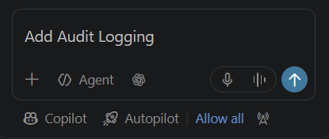
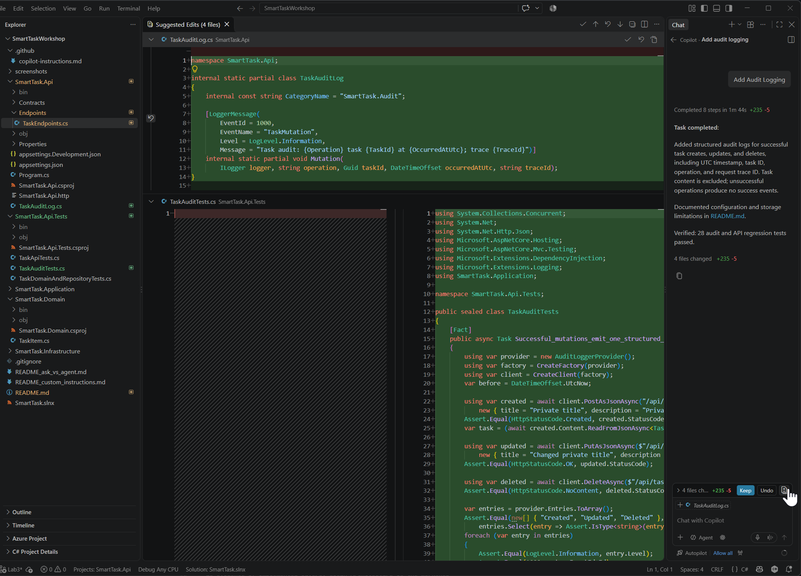
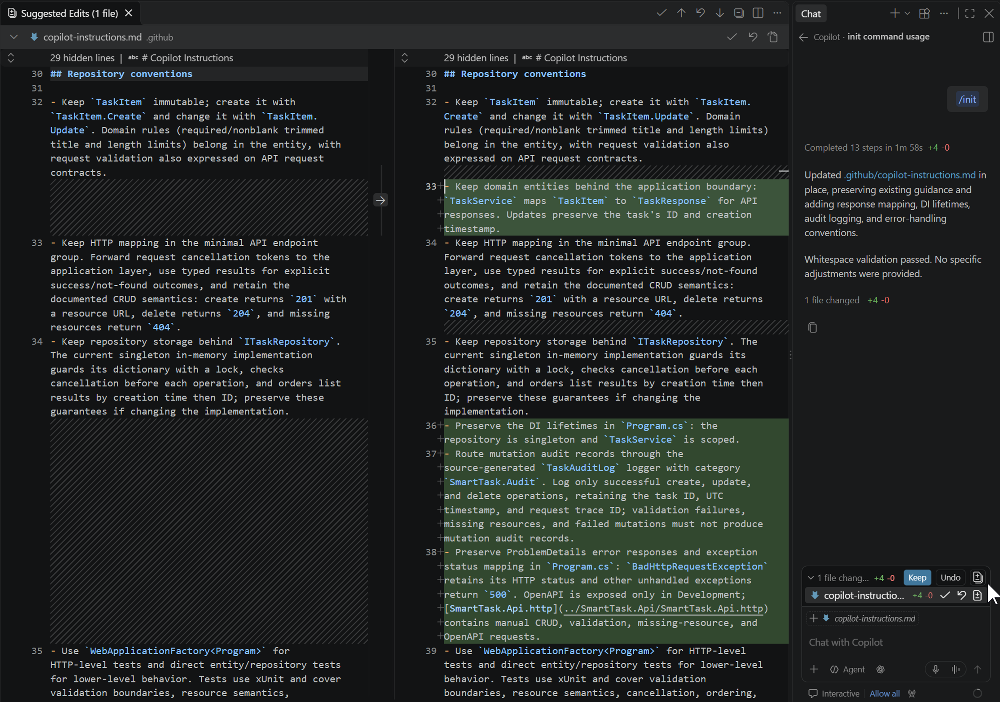
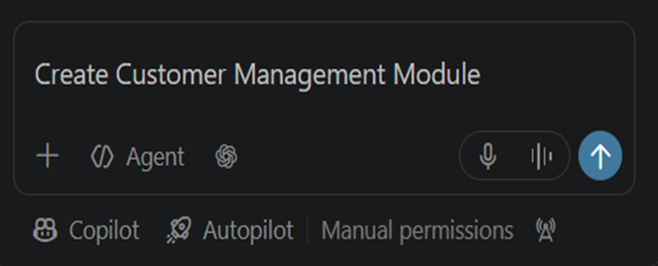
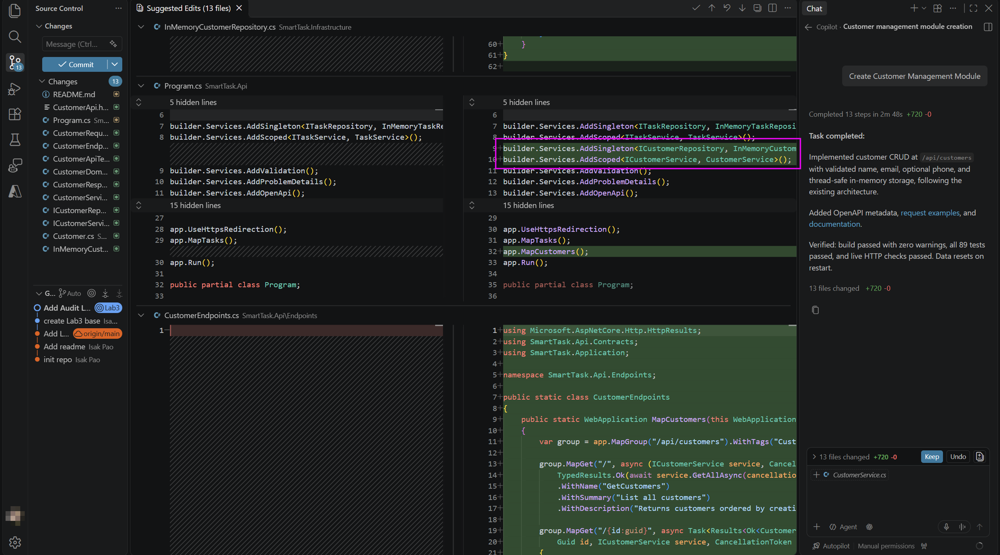

# Agent Mode Development

1. From `lab3_init` git tag, first, add Auditing log feature by this prompt:
   ```text
   Add Audit Logging
   ```
   
2. After Agent run finished, you may notice multiple source files are updated/added:
      
   (Note: you can revert the update descripitons on Top README.md)
3. Run `/init` to update GitHub Copilot repository level custom instruction file:
   
4. Add Customer Management Module by this prompt:
   ```
   Create Customer Management Module
   ```
   
5. After it finished, you will notice that a new _CustomerRepository_, _CustomerService_ following clean architecture of current project.
      