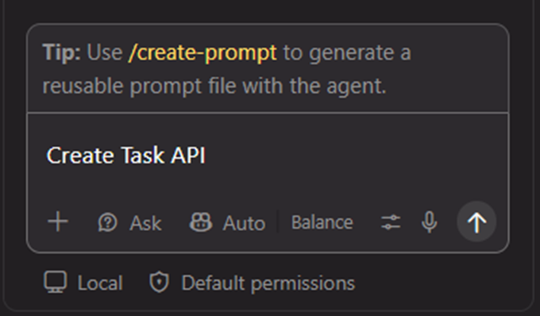
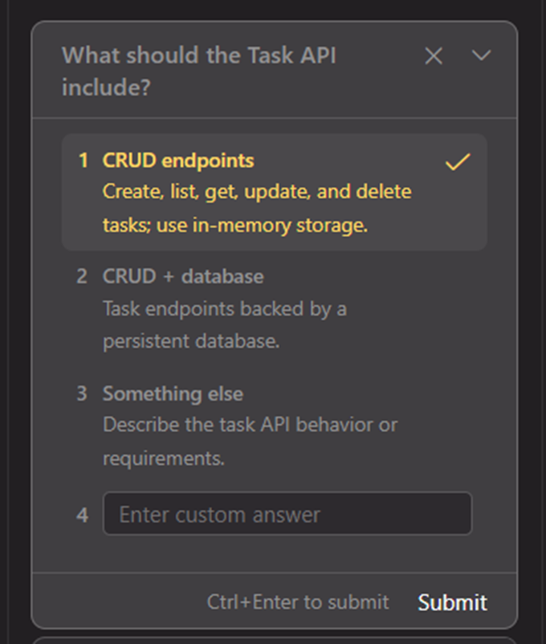
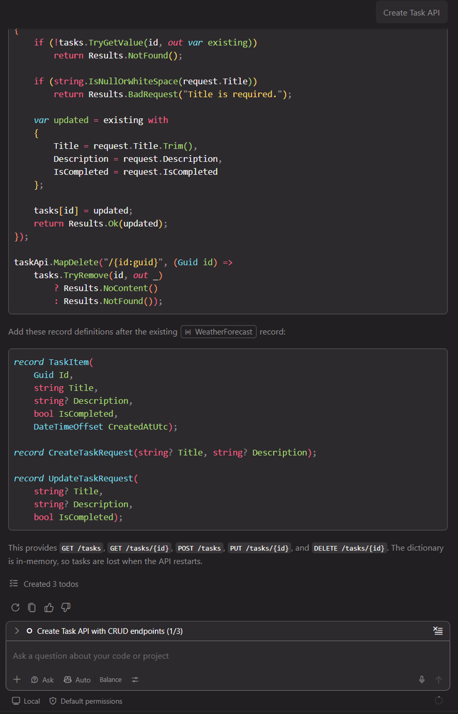
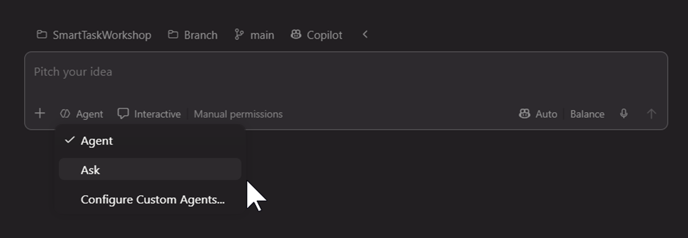
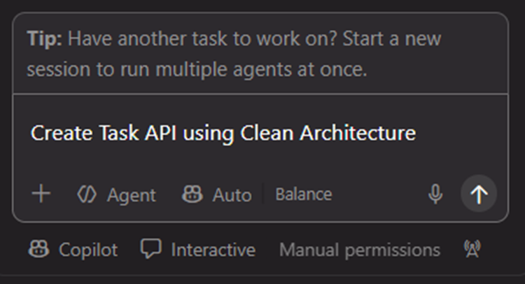
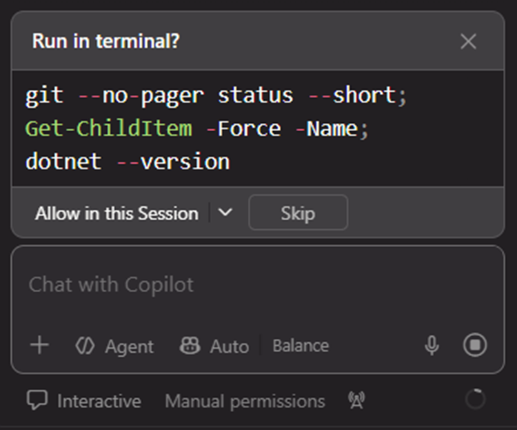
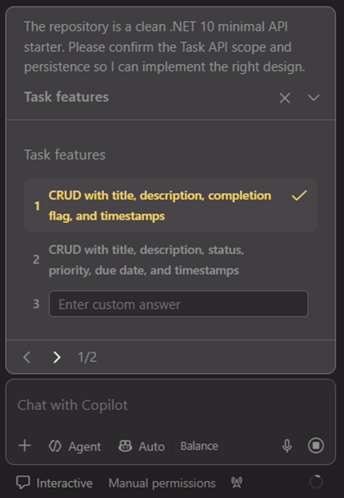
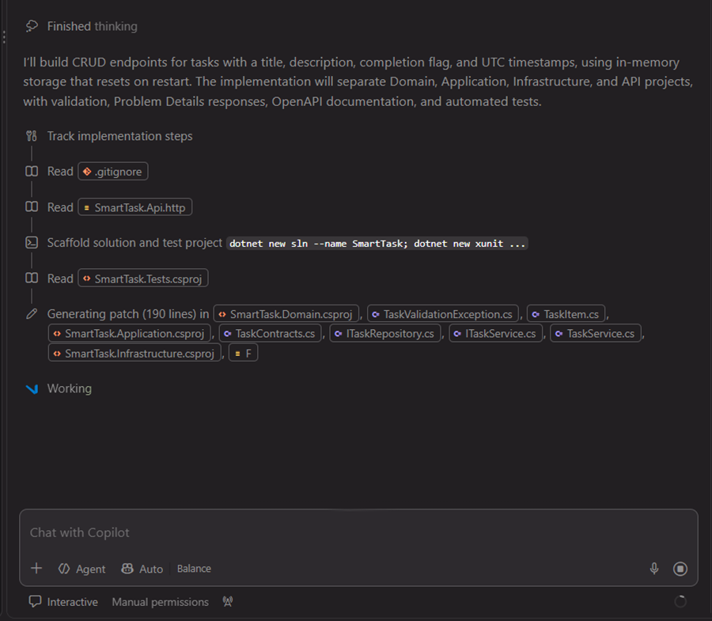
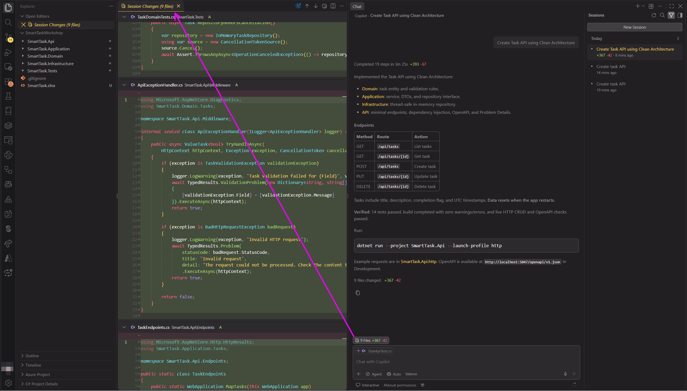

# Ask mode vs Agent mode 

## Practice Ask mode

1. Switch the GitHub Copilot in VSCode Chat View to "Ask" mode, use following prompt to start:
   ```
   Create Task API
   ```
   
2. If GithHub Copilot prompt to choose, select in-memory storage is fine:
   
3. Wait it finished, you can see AI only produce source code on Chat conversations UI, no source code files are created. 
   

Note: If you want to use Ask mode in Agent Window, the UI location is a little different, no Plan mode here:



## Practice Agent mode

1. Make GitHub Copilot in VSCode Chat View using default Agent, use following prompt to start:
   ```
   Create Task API using Clean Architecture
   ```
   
2. Grant permissions that Agent tries to do:
   
3. Answer questions agent raise, use in-memory storage solution is fine:
   
4. You will notice Agent mode did create new files:
   
5. When Agent finish its task, it will generate a whole clean architecture projects:
   