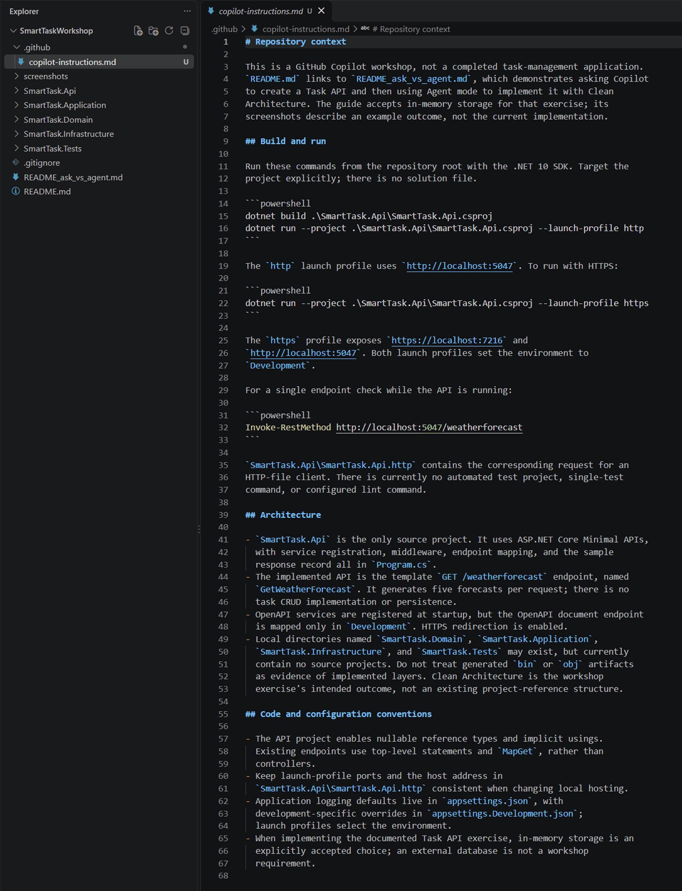

# Create GitHub Copilot Custom Instruction file

You can use VSCode Chat View with GitHub Copilot or GitHub Copilot CLI to generate repository-level custom instruction file.

Just at Chat interface type `/init` to start generate.

The generated file will reside in `.github/copilot-instructions.md`, like this example:

